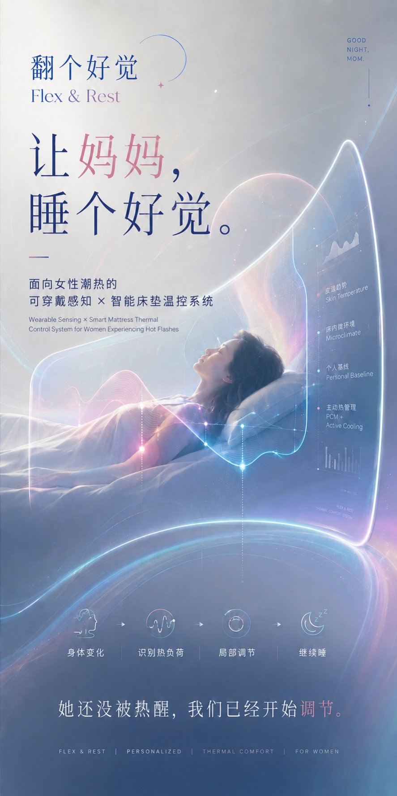
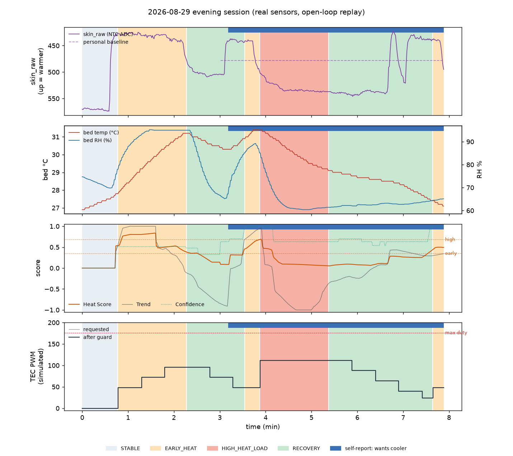
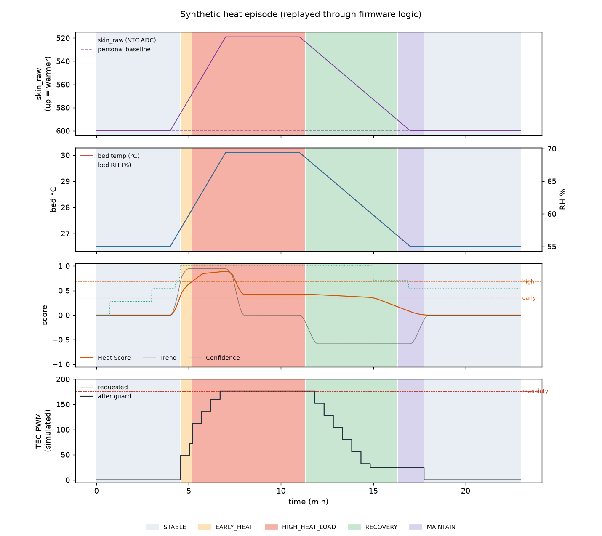
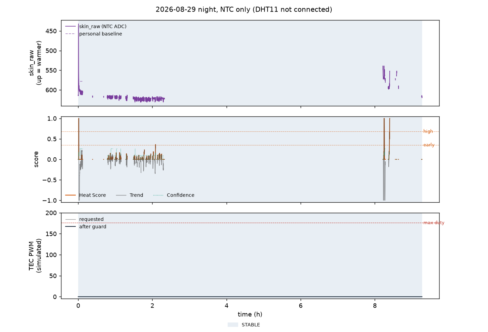

# 翻个好觉 Flex & Rest

**SheNicest 黑客松 · 蓝盒子命题作品**

一个夜间热舒适闭环原型：在热不适扩大之前，感知身体正在变热的趋势，做最小必要的局部降温，再看分数有没有回落。

*A nighttime thermal-comfort prototype for women's sleep: ESP32-S3 reads a skin-temperature trend (NTC) and the bed microclimate (DHT11), computes an explainable Heat Score against a personal baseline, and drives a graded, fail-closed state machine for a MOSFET-switched TEC (simulated in the demo).*

<p align="center"></p>

> 本项目不是医疗器械，不做诊断，不宣称任何医疗效果。它估计的是夜间热状态的变化趋势，面向的是睡眠中的热舒适。

---

## 1. 问题：夜里的冷和热是来回的

很多女性在睡眠中的冷热变化不是一个固定温度能解决的：经期前后、潮热、更年期等阶段，夜里可能突然热醒、出汗，掀开被子后又觉得冷，再盖回去。床品和空调通常只能设一个温度，等人醒了再手动调。

我们想回答的是：**能不能在热不适扩大之前就开始回应，并且在热退下去时逐级退出，不让降温本身变成下一次冷醒的原因。**

## 2. 命题与评分

蓝盒子命题：**做一款能智能调节冷暖的睡眠产品**——主动感知、判断并调节冷暖，鼓励软硬件结合完成闭环。

| 维度 | 权重 |
|---|---|
| 技术路径与专业判断 | 45% |
| 验证与工程实现 | 30% |
| 产品闭环与落地 | 20% |
| 问题定义 | 5% |

命题全文摘要、以及本作品对应的“采集 → 判断 → 指令 → 调节”链路见 [hackathon.md](hackathon.md)。

## 3. 系统设计

```text
 身体 ── NTC 皮温趋势 (GPIO1) ──┐
                               ├─> 安全检查 ─> 60 s 窗口 + 个人基线(前 180 s)
 床内 ── DHT11 温度/湿度 ───────┘                    │
                                          Heat Score / Trend / Confidence
                                                     │
                                   分级状态机（迟滞 · 最短停留 · 30 s 步进）
                                                     │
                       执行器保护（占空比 ≤69% · 连续开启 ≤30 min · 冷却 10 min）
                                                     │
                              MOSFET → TEC 局部降温（演示时为模拟执行器）
                                                     │
                                 干预响应：分数有没有回落？ ──> 串口 CSV 日志
```

| 层 | 选择 | 理由 |
|---|---|---|
| 皮温 | NTC 分压 → ESP32-S3 ADC，只用**趋势** | 便宜、响应快；个人差异大，所以看相对个人基线的偏移和变化速度，而不是绝对值 |
| 床内微环境 | DHT11 温湿度 | 出汗和被窝闷热会先体现在湿度上升；作为独立的第二、三组证据 |
| 判断 | 可解释的加权 Heat Score + 独立 Confidence | 每一次动作都能说出“哪几组证据、多确定”；单一皮温跳变不会触发 |
| 控制 | 六态状态机 STABLE / EARLY_HEAT / HIGH_HEAT_LOAD / RECOVERY / MAINTAIN / FAULT | 分级投入、逐级退出，迟滞防抖 |
| 执行 | 逻辑电平 MOSFET 低边开关 TEC，8 位 PWM | ESP32 不直接带负载；软件三重限制 + 要求独立硬件保护 |
| 被动层 | PCM 相变材料（概念） | 削峰储热，不受软件控制 |

详细接线和分层见 [architecture.md](architecture.md)。

## 4. 状态机

```text
                 early×3: score≥0.35 · trend≥0.12 · ≥2组证据 · conf≥0.45
   ┌────────── STABLE (PWM 0) ───────────────────────┐
   │ high×2: score≥0.68 · 3组证据 · conf≥0.60          ▼
   │                                         EARLY_HEAT (PWM 48, 每30s +24, ≤112)
   ▼                          high×2                  │
 HIGH_HEAT_LOAD (PWM 112, 仍在变热则每30s +24, ≤176) <─┤
   │ improving×3 · 停留≥90s                            │ improving×3 · 停留≥60s
   └──────────────────────────────> RECOVERY (每30s −24, ≥24) <┘
                                         │ PWM≤24 · score≤0.22
                                         ▼
                                   MAINTAIN (PWM 24) ── 复发 → EARLY / HIGH
                                         │ score≤0.15 · |trend|≤0.10 · ≥60s
                                         ▼
                                       STABLE

 任意状态 ── NTC 开路/短路 · DHT11 >10s 无数据 · 读数越界 · STOP ──> FAULT (PWM 0, 锁存, RESET 解除)
```

`improving` = `trend ≤ -0.12` 或 `score ≤ 0.40`。公式、迟滞、执行器保护和“有没有变好”的判定见 [state_machine.md](state_machine.md)。

## 5. 文件一览（全部在同一层）

| 文件 | 内容 |
|---|---|
| `main.cpp` | ESP32-S3 固件入口：传感器读取、串口命令、PWM 输出、CSV 日志 |
| `thermal_core.h` / `thermal_core.cpp` | 基线、Heat Score、状态机、执行器保护、响应判定（不依赖 Arduino） |
| `params.h` | 全部阈值与限制 |
| `platformio.ini` | PlatformIO 工程（`src_dir = .`，只编译 `main.cpp` 和 `thermal_core.cpp`） |
| `host_replay.cpp` | 在电脑上用同一份核心代码回放 CSV（测试用） |
| `flexrest_params.py` / `flexrest_engine.py` | 与固件逐行对应的 Python 实现 |
| `flexrest_logio.py` / `flexrest_replay.py` | 读写 CSV、解析串口日志、回放 |
| `simulate.py` | CSV → 同一套状态机 → 决策日志 |
| `parse_log.py` | 清洗串口原始输出（注释、重启、半行） |
| `plot_night.py` | 画图：皮温 / 床内温湿度 / Heat Score + 状态 / PWM |
| `capture_serial.py` | 采集串口到文件 |
| `test_*.py`, `conftest.py`, `synth.py`, `pytest.ini` | pytest 测试 |
| `data_2026-08-29_*.csv` | 两段真实采集（已匿名），说明见 [DATA.md](DATA.md) |
| `data_synthetic_heat_episode.csv` | 合成热事件，用于演示 |
| `img_*.png`, `img_poster.jpg` | 回放图与易拉宝 |
| `architecture.md`, `state_machine.md`, `hardware_safety.md`, `hackathon.md` | 设计文档 |

## 6. 构建与运行

### 固件

```bash
pip install platformio
pio run                      # 编译
pio run -t upload            # 烧录
pio device monitor           # 115200，每秒一行 CSV
```

默认 `FLEXREST_SIMULATE_ACTUATOR=1`：MOSFET 栅极始终为低，日志里的 `pwm_out` 表示“如果接上会输出多少”。改成 0 之前，必须先满足 [hardware_safety.md](hardware_safety.md) 的全部条件。

串口命令：`STOP`（锁存关闭）、`RESET`（解除 FAULT）、`BASELINE`（重新校准 180 s 基线）、`BASELINE:<raw>`（直接给定个人基线）、`HELP`。

### 主机工具

```bash
python3 -m venv .venv && source .venv/bin/activate
pip install -r requirements.txt

# 测试（包含 C++ 核心与 Python 的逐行一致性检查，需要 c++ 编译器）
pytest

# 回放真实数据
python simulate.py data_2026-08-29_evening_labeled.csv -o out/evening.csv
python plot_night.py out/evening.csv -o out/evening.png

# 只有皮温、没有 DHT11 的夜晚（默认会因缺少床内数据进入 FAULT）
python simulate.py data_2026-08-29_night_skin-only.csv --allow-missing-env -o out/night.csv

# 录一整晚并画图
python capture_serial.py --port /dev/cu.usbmodemXXXX -o captures/night.txt
python parse_log.py captures/night.txt -o out/night_log.csv
python plot_night.py out/night_log.csv -o out/night_log.png
```

## 7. 数据样例

**2026-08-29 晚间会话**（真实 NTC + DHT11，474 行，测试者自报“想要更凉”用蓝条标出），开环回放：



`skin_raw` 轴已翻转（向上 = 变热）。开头 NTC 贴上皮肤、床内湿度上升时，系统进入 EARLY_HEAT 并逐档加功率；湿热回落后进入 RECOVERY 逐档降功率；约 4 min 处温湿度再次同时上升，升级到 HIGH_HEAT_LOAD。这一段是工程验证：执行器是模拟的，记录的数据没有受到输出影响，所以它只说明**控制器会怎么决定**，不说明降温效果。

**合成热事件**（平稳 → 上升 → 平台 → 回落），完整走一遍 STABLE → EARLY → HIGH → RECOVERY → MAINTAIN → STABLE：



**2026-08-29 夜间会话**（约 9.3 h，仅 NTC，DHT11 未接入）：只有一组证据，达不到“至少两组独立证据”的门槛，整晚不动作。这正是设计意图——单一信号不触发主动降温。



日志片段（晚间会话回放；设备串口、C++ 回放和 `simulate.py` 输出逐字节一致，simulate 额外带 `boot`、`label` 两列）：

```csv
t_s,skin_raw,env_temp,humidity,baseline_ready,skin_baseline,heat_score,trend_score,confidence,evidence,state,action,reason,pwm_req,pwm_out,guard,response
46.975,428,27.8,78.0,0,,0.5361,0.5669,0.5137,2,EARLY_HEAT,START_LOW,persistent_early_heat_trend,48,48,ok,WAITING_FOR_RESPONSE
232.973,503,31.4,85.1,1,478.28,0.6865,0.9498,1.0000,3,HIGH_HEAT_LOAD,ESCALATE,heat_load_became_high,112,112,ok,WAITING_FOR_RESPONSE
322.973,537,29.1,61.4,1,478.28,0.0540,-0.3587,0.6313,1,RECOVERY,BEGIN_RAMP_DOWN,heat_trend_converging,112,112,ok,IMPROVING
```

数据说明见 [DATA.md](DATA.md)。

## 8. 边界

- `skin_raw` 是未标定的 ADC 趋势，不是体温。
- 阈值和权重是工程初值，需要更多真实夜晚来调整。
- 样本量很小，不能得出任何人体效果结论。
- 贴肤、过夜使用前必须有独立的硬件热保护和人工监护，见 [hardware_safety.md](hardware_safety.md)。

## License

[MIT](LICENSE)

---

### English summary

**Flex & Rest** is a SheNicest hackathon entry for the 蓝盒子 (Lanhezi) prompt *"build a sleep product that intelligently regulates warmth and coolness."* Women's nighttime thermal discomfort often swings both ways — waking up hot and sweaty, then feeling cold after throwing off the covers. The prototype tries to respond **before** heat discomfort builds up, and to back off step by step as it subsides.

- **Sensing:** NTC skin-temperature *trend* on GPIO1 (raw ADC, not °C) and a DHT11 bed microclimate sensor (temperature + humidity), sampled at 1 Hz on an ESP32-S3.
- **Judgement:** 60 s rolling window, personal baseline from the first 180 s, an explainable Heat Score (0..1) from six weighted evidence components in three independent groups, a signed Trend, and a separate Confidence.
- **Control:** STABLE / EARLY_HEAT / HIGH_HEAT_LOAD / RECOVERY / MAINTAIN / FAULT with consecutive-window confirmation, minimum dwell times and 30 s power steps (hysteresis); fail-closed latched FAULT on sensor problems.
- **Actuation:** MOSFET-switched TEC via 8-bit PWM, **simulated by default**; an independent guard enforces max duty (176/255), max continuous on-time (30 min) and a 10 min cooldown.
- **Tools:** Python mirror of the firmware core, serial log parser, night plotter, CSV replay simulator, and pytest suite — including a parity test that compiles the C++ core on the host and checks it matches Python second by second.

Not a medical device; no diagnostic or therapeutic claims. Bench prototype only.
